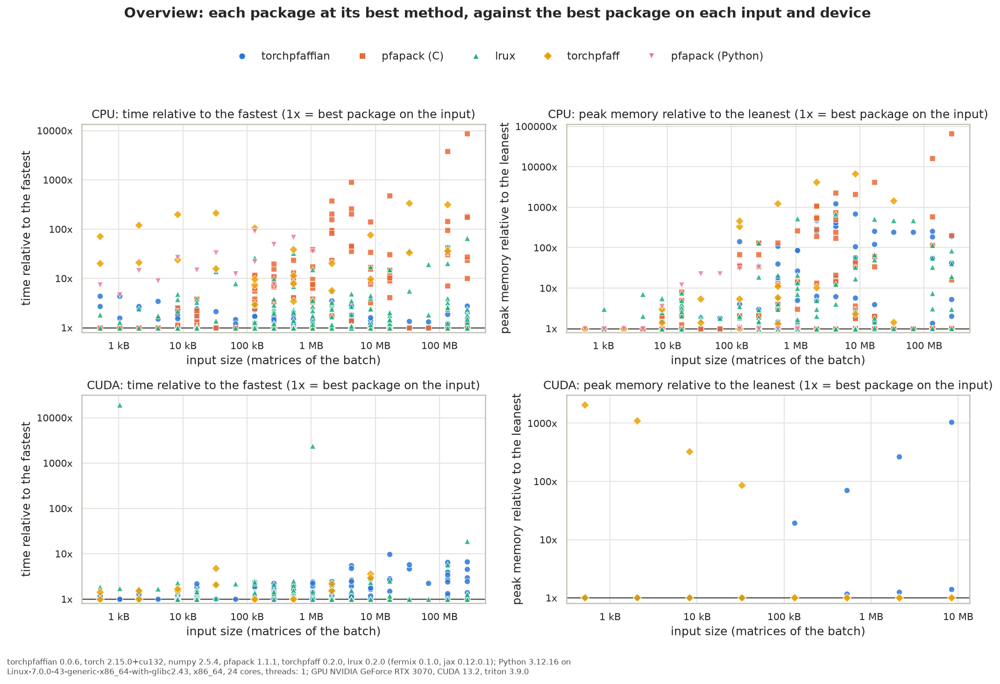

Performance
===========

This page compares TorchPfaffian with three other libraries, on CPU and on a GPU:

- `pfapack <https://github.com/basnijholt/pfapack>`_, the reference Pfaffian library (NumPy, one matrix at a
  time, double precision, no gradients or GPU); its C implementation is used;
- `torchpfaff <https://github.com/Nuclear-Physics-with-Machine-Learning/PyPfaffian>`_, a differentiable
  PyTorch Pfaffian with a Triton kernel on CUDA, for real matrices;
- `lrux <https://github.com/ChenAo-Phys/lrux>`_, JAX low-rank updates of determinants and Pfaffians, whose full
  Pfaffian comes from `fermix <https://github.com/ChenAo-Phys/fermix>`_ (JAX/Pallas kernels on GPU, a generic
  ``jax.numpy`` fallback on CPU), jitted.

Every library computes the signed Pfaffian of the same random skew-symmetric matrices, scaled so that ``|Pf|``
stays near 1, and agrees with pfapack. The times are per matrix: for a batch, the time of the whole batch divided
by its size; pfapack is called on each matrix, the others take the batch in one call. "+ gradient" includes the
backward pass. The fastest library of each row is in bold, and "—" means not measured: torchpfaff has no complex
support and its CUDA kernel is not run above ``m = 64`` (it compiles for minutes), and pfapack has no gradient.
A method whose first call takes more than 10 s is timed from that call, compilation included (torchpfaff on CUDA
at ``m = 64``).

Measured with torchpfaffian 0.0.6 (development build), torch 2.15.0+cu132, numpy 2.5.4, pfapack 1.1.1,
torchpfaff 0.2.0, lrux 0.2.0 (fermix 0.1.0, jax 0.12.0.1), Python 3.12.16 on Linux x86_64 (AMD Ryzen 9 3900X),
one CPU thread, and an NVIDIA GeForce RTX 3070 (CUDA 13.2, Triton 3.9.0). Times on another machine differ;
``benchmarks/library_comparison.py`` reproduces the measurement and ``benchmarks/plot_results.py`` plots it (see
``benchmarks/README.md``).

Overview
--------

Each library at its best method on each input and device, divided by the fastest library there (1x is the best),
against the input size; time on the left, peak memory per call on the right, CPU above and CUDA below. Over all
the inputs, TorchPfaffian is the fastest on 51% of the CPU inputs and 35% of the CUDA ones, at a geometric mean of
1.3x and 1.5x of the fastest; lrux on 34% and 61%, at 2.0x and 1.4x.

Full Pfaffians
--------------

Pfaffian, float64:

===  =====  ================  ==================  ===================  ===============  ================  =========  ===========
m    batch  pfapack (C), CPU  TorchPfaffian, CPU  TorchPfaffian, CUDA  torchpfaff, CPU  torchpfaff, CUDA  lrux, CPU  lrux, CUDA 
===  =====  ================  ==================  ===================  ===============  ================  =========  ===========
8    1      **8.0 µs**        21.5 µs             141.9 µs             569.9 µs         129.1 µs          14.5 µs    237.8 µs   
8    256    8.1 µs            0.9 µs              1.6 µs               5.3 µs           **0.7 µs**        0.7 µs     1.7 µs     
16   1      **9.4 µs**        22.5 µs             145.6 µs             1.12 ms          136.8 µs          22.8 µs    234.6 µs   
16   256    8.0 µs            2.0 µs              1.7 µs               22.9 µs          **1.3 µs**        4.7 µs     1.7 µs     
32   1      **11.1 µs**       27.7 µs             152.0 µs             2.20 ms          230.3 µs          53.5 µs    254.7 µs   
32   256    10.6 µs           6.1 µs              2.7 µs               122.0 µs         3.3 µs            33.9 µs    **2.2 µs** 
64   1      **21.3 µs**       45.8 µs             173.0 µs             4.52 ms          833.0 µs          296.4 µs   369.2 µs   
64   256    22.2 µs           23.8 µs             11.9 µs              1.69 ms          15.6 µs           388.9 µs   **4.3 µs** 
128  1      **97.9 µs**       164.7 µs            335.7 µs             10.49 ms         —                 2.57 ms    760.6 µs   
128  256    107.3 µs          145.0 µs            62.9 µs              36.51 ms         —                 4.09 ms    **13.4 µs**
256  1      **842.9 µs**      857.6 µs            1.12 ms              33.08 ms         —                 27.72 ms   2.21 ms    
256  256    894.2 µs          1.10 ms             302.4 µs             285.38 ms        —                 39.78 ms   **54.2 µs**
===  =====  ================  ==================  ===================  ===============  ================  =========  ===========

Pfaffian, complex128:

===  =====  ================  ==================  ===================  ==========  ===========
m    batch  pfapack (C), CPU  TorchPfaffian, CPU  TorchPfaffian, CUDA  lrux, CPU   lrux, CUDA 
===  =====  ================  ==================  ===================  ==========  ===========
8    1      **14.2 µs**       22.2 µs             198.8 µs             18.3 µs     341.8 µs   
8    256    13.4 µs           1.3 µs              2.3 µs               **1.3 µs**  3.5 µs     
16   1      **15.6 µs**       23.5 µs             202.5 µs             27.3 µs     342.1 µs   
16   256    15.1 µs           3.9 µs              5.1 µs               10.6 µs     **3.5 µs** 
32   1      **21.8 µs**       33.6 µs             211.0 µs             84.5 µs     348.6 µs   
32   256    22.2 µs           16.1 µs             19.2 µs              78.1 µs     **3.5 µs** 
64   1      **68.3 µs**       99.7 µs             290.3 µs             538.8 µs    638.1 µs   
64   256    70.3 µs           88.8 µs             95.2 µs              1.04 ms     **9.7 µs** 
128  1      **443.9 µs**      599.8 µs            845.1 µs             4.38 ms     1.79 ms    
128  256    452.5 µs          591.7 µs            113.2 µs             8.66 ms     **51.1 µs**
256  1      **3.34 ms**       4.90 ms             5.25 ms              50.52 ms    12.46 s    
256  256    3.46 ms           5.42 ms             **742.5 µs**         —           —          
===  =====  ================  ==================  ===================  ==========  ===========

Pfaffian + gradient, float64:

===  =====  ==================  ===================  ===============  ================  ===========  ============
m    batch  TorchPfaffian, CPU  TorchPfaffian, CUDA  torchpfaff, CPU  torchpfaff, CUDA  lrux, CPU    lrux, CUDA  
===  =====  ==================  ===================  ===============  ================  ===========  ============
8    1      152.9 µs            414.3 µs             714.7 µs         499.0 µs          **35.0 µs**  347.7 µs    
8    256    3.0 µs              4.7 µs               7.0 µs           **1.9 µs**        2.4 µs       2.8 µs      
16   1      163.4 µs            425.1 µs             1.27 ms          503.2 µs          **60.1 µs**  329.4 µs    
16   256    7.8 µs              4.9 µs               27.0 µs          **2.5 µs**        11.0 µs      2.9 µs      
32   1      192.5 µs            449.0 µs             2.35 ms          583.4 µs          **97.7 µs**  345.3 µs    
32   256    28.2 µs             7.4 µs               162.1 µs         6.6 µs            81.1 µs      **3.0 µs**  
64   1      **295.9 µs**        578.6 µs             4.70 ms          1.22 ms           405.7 µs     603.2 µs    
64   256    186.3 µs            25.7 µs              1.83 ms          26.6 µs           741.5 µs     **9.0 µs**  
128  1      **1.14 ms**         1.30 ms              11.03 ms         —                 3.26 ms      1.26 ms     
128  256    1.12 ms             202.8 µs             37.80 ms         —                 6.24 ms      **34.9 µs** 
256  1      4.56 ms             **3.13 ms**          36.13 ms         —                 31.78 ms     3.44 ms     
256  256    7.97 ms             993.1 µs             288.97 ms        —                 31.65 ms     **168.0 µs**
===  =====  ==================  ===================  ===============  ================  ===========  ============

Pfaffian + gradient, complex128:

===  =====  ==================  ===================  ============  ==========
m    batch  TorchPfaffian, CPU  TorchPfaffian, CUDA  lrux, CPU     lrux, CUDA
===  =====  ==================  ===================  ============  ==========
8    1      198.0 µs            531.1 µs             **45.5 µs**   10.26 s   
8    256    6.5 µs              6.0 µs               **3.9 µs**    —         
16   1      214.7 µs            553.0 µs             **62.9 µs**   —         
16   256    25.7 µs             **9.2 µs**           23.3 µs       —         
32   1      315.0 µs            663.3 µs             **168.1 µs**  —         
32   256    141.1 µs            **29.2 µs**          156.1 µs      —         
64   1      1.05 ms             1.38 ms              **867.5 µs**  —         
64   256    926.9 µs            **137.8 µs**         1.65 ms       —         
128  1      2.78 ms             **2.57 ms**          6.88 ms       —         
128  256    6.57 ms             **455.3 µs**         11.90 ms      —         
256  1      18.98 ms            **9.78 ms**          67.78 ms      —         
256  256    26.10 ms            **2.65 ms**          61.70 ms      —         
===  =====  ==================  ===================  ============  ==========

Pfaffian ratios under low-rank updates
--------------------------------------

``benchmarks/library_comparison.py --ratios`` times :class:`~torch_pfaffian.low_rank.LowRankPfaffian` and
:class:`~torch_pfaffian.low_rank.PfaffianUpdater` against lrux's ``pf_lru`` and ``pf_lru_delayed``, and against
computing the Pfaffian of the updated matrix with pfapack, in float64 (times per update). "rank 2" is one dense
update ``A - u J u^T``, "row" one row and column replaced, and "row x16" sixteen successive accepted row
replacements, with immediate or delayed (``T = 4``) inverse updates. "ratio + inverse" also updates the inverse,
which the next move needs.

rank 2, ratio:

===  =====  =========================  ==================  ===================  ===========  ==========
n    batch  pfapack (C), new Pfaffian  TorchPfaffian, CPU  TorchPfaffian, CUDA  lrux, CPU    lrux, CUDA
===  =====  =========================  ==================  ===================  ===========  ==========
32   1      11.9 µs                    17.6 µs             122.9 µs             **10.6 µs**  162.0 µs  
32   64     10.7 µs                    **0.8 µs**          2.0 µs               0.9 µs       2.5 µs    
128  1      100.7 µs                   20.4 µs             129.6 µs             **18.1 µs**  175.3 µs  
128  64     103.5 µs                   3.3 µs              5.1 µs               7.2 µs       **2.7 µs**
512  1      9.96 ms                    **49.1 µs**         134.2 µs             53.2 µs      186.3 µs  
512  64     9.94 ms                    82.9 µs             59.9 µs              69.1 µs      **9.3 µs**
===  =====  =========================  ==================  ===================  ===========  ==========

rank 2, ratio + inverse:

===  =====  =========================  ==================  ===================  ==========  ===========
n    batch  pfapack (C), new Pfaffian  TorchPfaffian, CPU  TorchPfaffian, CUDA  lrux, CPU   lrux, CUDA 
===  =====  =========================  ==================  ===================  ==========  ===========
32   1      **11.9 µs**                21.8 µs             232.3 µs             12.0 µs     163.3 µs   
32   64     10.7 µs                    1.4 µs              3.7 µs               **1.3 µs**  2.6 µs     
128  1      100.7 µs                   **29.9 µs**         238.2 µs             35.9 µs     172.6 µs   
128  64     103.5 µs                   13.5 µs             8.4 µs               13.6 µs     **4.6 µs** 
512  1      9.96 ms                    **123.1 µs**        320.7 µs             377.9 µs    221.1 µs   
512  64     9.94 ms                    326.5 µs            106.5 µs             776.4 µs    **39.2 µs**
===  =====  =========================  ==================  ===================  ==========  ===========

row, ratio:

===  =====  =========================  ==================  ===================  ==========  ==========
n    batch  pfapack (C), new Pfaffian  TorchPfaffian, CPU  TorchPfaffian, CUDA  lrux, CPU   lrux, CUDA
===  =====  =========================  ==================  ===================  ==========  ==========
32   1      24.3 µs                    23.1 µs             112.0 µs             **9.5 µs**  170.5 µs  
32   64     12.1 µs                    0.8 µs              1.8 µs               **0.5 µs**  2.9 µs    
128  1      116.1 µs                   23.4 µs             111.3 µs             **9.9 µs**  176.6 µs  
128  64     111.3 µs                   **0.8 µs**          1.8 µs               1.9 µs      2.7 µs    
512  1      9.86 ms                    **26.3 µs**         111.3 µs             44.4 µs     170.6 µs  
512  64     10.04 ms                   2.6 µs              **1.8 µs**           52.8 µs     7.6 µs    
===  =====  =========================  ==================  ===================  ==========  ==========

row, ratio + inverse:

===  =====  =========================  ==================  ===================  ===========  ===========
n    batch  pfapack (C), new Pfaffian  TorchPfaffian, CPU  TorchPfaffian, CUDA  lrux, CPU    lrux, CUDA 
===  =====  =========================  ==================  ===================  ===========  ===========
32   1      24.3 µs                    27.7 µs             286.5 µs             **11.2 µs**  163.0 µs   
32   64     12.1 µs                    1.4 µs              4.5 µs               **0.9 µs**   2.9 µs     
128  1      116.1 µs                   **33.8 µs**         284.7 µs             43.9 µs      162.0 µs   
128  64     111.3 µs                   10.7 µs             7.0 µs               6.6 µs       **4.7 µs** 
512  1      9.86 ms                    **108.1 µs**        302.2 µs             278.9 µs     187.2 µs   
512  64     10.04 ms                   304.7 µs            49.5 µs              784.2 µs     **39.7 µs**
===  =====  =========================  ==================  ===================  ===========  ===========

row x16, immediate updates:

===  =====  =========================  ==================  ===================  ===========  ===========
n    batch  pfapack (C), new Pfaffian  TorchPfaffian, CPU  TorchPfaffian, CUDA  lrux, CPU    lrux, CUDA 
===  =====  =========================  ==================  ===================  ===========  ===========
32   1      21.6 µs                    29.7 µs             276.5 µs             **19.3 µs**  115.7 µs   
32   64     11.4 µs                    1.3 µs              4.3 µs               **1.1 µs**   1.9 µs     
128  1      114.7 µs                   **34.8 µs**         271.3 µs             45.3 µs      119.1 µs   
128  64     104.9 µs                   12.1 µs             4.4 µs               13.8 µs      **2.9 µs** 
512  1      9.90 ms                    **117.8 µs**        276.3 µs             279.1 µs     120.2 µs   
512  64     10.05 ms                   302.1 µs            47.9 µs              790.8 µs     **35.5 µs**
===  =====  =========================  ==================  ===================  ===========  ===========

row x16, delayed updates (T=4):

===  =====  =========================  ==================  ===================  =========  ===========
n    batch  pfapack (C), new Pfaffian  TorchPfaffian, CPU  TorchPfaffian, CUDA  lrux, CPU  lrux, CUDA 
===  =====  =========================  ==================  ===================  =========  ===========
32   1      **21.6 µs**                25.0 µs             449.1 µs             81.6 µs    193.3 µs   
32   64     11.4 µs                    **1.2 µs**          7.1 µs               2.5 µs     3.0 µs     
128  1      114.7 µs                   **30.1 µs**         446.9 µs             93.3 µs    201.2 µs   
128  64     104.9 µs                   6.7 µs              8.6 µs               30.2 µs    **3.1 µs** 
512  1      9.90 ms                    **105.3 µs**        460.4 µs             348.2 µs   198.5 µs   
512  64     10.05 ms                   237.9 µs            82.7 µs              773.1 µs   **24.2 µs**
===  =====  =========================  ==================  ===================  =========  ===========

Reading the results
-------------------

- On a single matrix on CPU, pfapack is the fastest: TorchPfaffian has a fixed cost of about 13 µs per call
  (checks, dispatch), and its Rust kernel is up to about 1.7x slower than pfapack's on one large matrix.
- On a batch of small matrices, TorchPfaffian is faster than pfapack even on one thread, since one call
  amortizes the fixed cost: the typical workload of matchgate simulation.
- On CUDA, small inputs are computed by the Rust kernel on the host, and larger real ones by one Triton kernel
  per batch. TorchPfaffian is the fastest on single float64 matrices from ``m = 32`` and on every single complex
  one, and lrux on batches, where fermix's kernels use the GPU best (this GeForce card has slow float64
  arithmetic), except complex ``m = 256``.
- The gradient costs a few times the forward pass. It is the main reason to use TorchPfaffian or torchpfaff:
  pfapack has none.
- For low-rank updates on CPU, TorchPfaffian is faster than lrux from ``n = 128`` on most moves, single and
  batched, and on every chain of moves with delayed updates; it is 1.1 to 2.5x slower at ``n = 32`` and on single
  row ratios at ``n = 128``. On CUDA, lrux is faster on most inputs, TorchPfaffian on batched ratios without the
  inverse.
